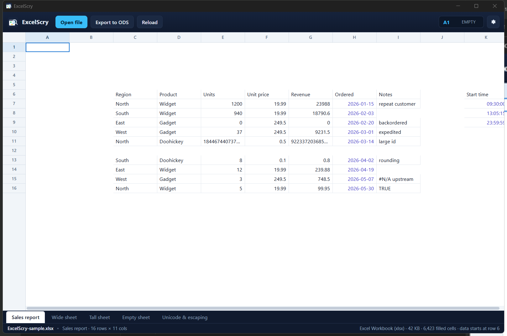
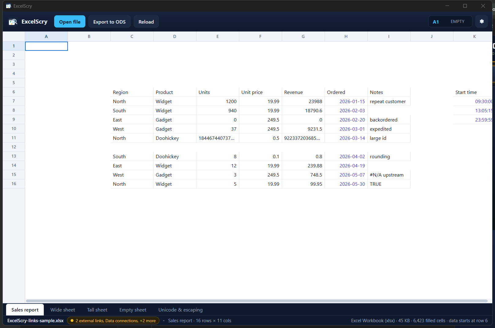
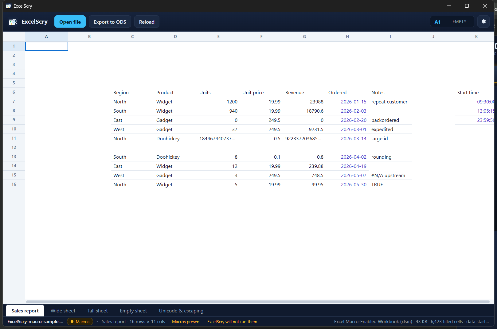

# ExcelScry

A fast desktop viewer for Excel workbooks and OpenDocument spreadsheets, built
with Rust and Tauri 2. It renders sheets in a virtualised grid, exports any open
workbook to **ODS**, and ships as both a **portable executable** and an **NSIS
installer** that adds a *Scry Excel File* entry to the Windows context menu and
registers ExcelScry with Windows' Default Apps list.



## What it does

- **Reads** `.xlsx`, `.xlsm`, `.xlsb`, `.xls`, `.xla` and `.ods` (everything
  [calamine](https://crates.io/crates/calamine) supports). An OpenDocument
  spreadsheet gets the same viewer as an Excel workbook — the same grid, sheet
  tabs, trust badge and export — and the same shell integration.
- **Reads delimited text too.** `.csv` and `.tsv` open in the same grid as a
  single sheet named after the file: RFC 4180 quoting (a field may hold the
  delimiter, doubled quotes and line breaks), `CRLF`/`LF`/`CR` records, ragged
  rows, a UTF-8 BOM skipped and UTF-16 with a BOM decoded (what Excel's
  *Unicode Text* export writes). A `.csv` that uses `;` or a tab instead of a
  comma is recognised from its first record. Values stay text — `000123` and
  `1E5` are shown as the file spells them rather than reparsed as numbers.
  The bytes settle the encoding before the first record is read: UTF-8 when
  they are UTF-8, UTF-16 either way round with or without a byte order mark
  (the zero byte beside every character gives a Windows tool's export away),
  and, for bytes that are neither, the encoding is read statistically from the
  file's own text. That is what makes a Japanese export open as Japanese: the
  detector weighs the candidate encodings by what they can decode and by the
  character pairs their languages actually use, so Shift_JIS, EUC-JP,
  ISO-2022-JP, GBK, Big5 and EUC-KR are each recognised, as are the Windows
  code pages (`1250`–`1258` and `874`), ISO-8859-2, -4, -5, -6, -7, -8 and
  -13, KOI8-U and IBM866 — a Cyrillic, Greek or Hebrew file no longer arrives
  as a wall of Western mojibake. A file with only a handful of
  accented bytes is not enough text to choose from, and is read as
  Windows-1252, which is what such a file almost always is. A delimiter that
  reads either way is still a guess, and a bar above the grid names the
  delimiter and encoding the file was read with and can re-read it with
  another: comma, semicolon, tab or pipe; UTF-8, UTF-16 either way round, or any
  of those legacy encodings chosen from a list grouped by script. Reload keeps
  the choice, and Auto puts the guess back. A choice is
  remembered for the file it was made for, so the weekly export that arrives
  semicolon-separated is opened that way next week without touching the bar;
  editing or replacing the file drops it, because a new export at the same path
  should be read by its own bytes. Choosing Auto forgets it again. The first
  record stays pinned above the grid as you scroll — in a delimited file that row is
  the header, and its row number rides along with it. A file exported with a
  title or a note above its column names can name another row instead: the
  bar's *Header row* field, or a click on that row's number, moves the pin, and
  everything above the chosen row scrolls away with the rest. Clearing the
  field, or clicking the chosen number again, leaves nothing pinned; the
  choice survives a reload or another delimiter, because it belongs to the open
  file rather than to its bytes, and it is kept between sessions like the
  delimiter: the weekly export reopens with row 3 still held above the grid, and
  a file deliberately left unpinned reopens with no header rather than its
  first record coming back. That row also names the columns: the strip along
  the top of the grid reads *Region*, *Product*, *Units* instead of A, B, C,
  with the letter kept in the tooltip and a long name cut with an ellipsis. A
  column whose header cell is empty keeps its letter, unpinning puts every
  letter back, and a workbook keeps them always — its rows are data, not a
  table with a header. A file read in another encoding can then be
  saved back out as UTF-8: the bar offers *Save a copy as UTF-8* while the
  encoding is anything but UTF-8, which writes the same records with the same
  quoting and line endings through the decoder the grid used, so the accented
  names that were shown are the ones written. It saves a copy under a new name
  and never rewrites the original, which is also why the button disappears once
  the file is read as UTF-8 — there would be nothing to convert.
- **A delimited file's rows can be ordered by one of its columns.** A CSV that
  arrives in whatever order the last export wrote it in reads as a wall of
  records. Clicking a named column's head in the strip now sorts the records by
  that column, and clicking it again reverses the order — the head keeps an
  arrow saying which one is showing, and the status bar repeats it. Numbers
  compare as numbers, so `9` comes before `10`; text compares without regard to
  case; a blank field sorts last whichever direction is asked for. The pinned
  header and anything above it keep their places, so an export with a title or
  a note still reads as a document rather than having its preamble shuffled
  into the data. This is a view of the rows, not an edit: the file on disk is
  never written. It is a view worth coming back to, so the order is remembered
  for the file beside its delimiter and header row, and the export reopens in
  it — the rows are already in that order when the grid is first painted, with
  the arrow and the status bar naming it. *File order* in the delimited-text
  bar puts the records back the way the file has them, moving the rows in
  memory rather than reading the file again, and stops remembering the order. A
  workbook keeps its own row order — its rows are a layout, not a list of
  records — so its column heads stay plain letters and are not sort controls.
- **Every file reopens where it was left.** A workbook is rarely read from its
  first row, and getting back to the place meant scrolling there again. The
  grid now remembers, per file, the sheet that was in front, the cell that was
  selected and the scroll offset, and puts all three back when the file is
  opened again; a workbook reopens on the tab that was in front, with that
  tab's own position. The position is written a moment after the moving stops,
  so moving around is not a write per keypress, and a move still waiting when
  another file is opened is written first, against the file it belongs to. The
  store records each file's length and modification time beside the position,
  so a different export put at the same path opens at its own top instead of
  inheriting the row the old file was left on; an unreadable store is ignored
  and the file opens at A1 as it would have.
- **Column widths are the reader's to set, and they stay set.** A report's own
  columns are sometimes too narrow for the notes in them and too wide for the
  dates, so every column's right edge in the letter strip is a grip: dragging it
  widens or narrows that column, and the grid lays the rest of the sheet out
  around it as it moves. The width is remembered per sheet, per file, beside the
  sheet, cell and scroll offset the file reopens at, so the table comes back
  the shape it was read in; switching tabs gives each tab its own widths back
  rather than lending one sheet's shape to another, and double-clicking an edge
  puts that column back to the width the file gives it. Nothing is written to
  the workbook — a widened column is how the file is read, not an edit to it —
  and the export still carries the sheet's own widths.
- **Recent files are one click away.** The welcome screen lists the last eight
  files opened, newest first, with the full path under the name; clicking one
  opens it again. The list is stored per user and pruned when a file is gone,
  and another spelling of the same path does not appear twice.
- **Says what the file carries before you open it elsewhere.** A badge in the
  status bar reports macros, external links, external data connections,
  embedded objects and ActiveX controls, and opens a dialog with the detail.
- **Never runs any of it.** An `.xlsm` is opened as plain data: the VBA project
  inside `xl/vbaProject.bin` is not executed, extracted or written anywhere,
  and the inspector only reads the package's member list. That makes ExcelScry
  a safe way to look inside a workbook from a source you do not trust, and
  `.xlsm` gets the same shell registration as the other Excel formats.
- **Frozen rows and columns stay in place.** A workbook that freezes its
  header row, its label column or both keeps that band on screen while the
  rest of the sheet scrolls, with the frozen row numbers and column letters
  pinned alongside it. Excel stores the split in the sheet's `<pane>` element;
  LibreOffice stores it in the ODS view settings, and both are read. Clicking,
  arrow keys and scrolling all work across the frozen boundary; a text table's
  chosen header row remains a separate pin.
- **The view switches live in one menu.** What the sheet hides, where its data
  begins and where the part that scrolls begins used to be scattered — a
  toolbar button that appeared only for some files, and two places the reader
  had to find by hand. **View** now opens a menu that carries all three: the
  hidden-rows switch with the count and a tick when they are being shown,
  **Jump to data** (`Ctrl+Shift+J`) for the corner of the data rather than A1,
  and **First scrolling cell** (`Ctrl+Shift+Home`) for the cell where the
  scrolling area begins, past any frozen rows and columns or pinned header.
  Both jumps put their target at the top-left of the view instead of merely
  scrolling it into sight, and neither lands under the band it just cleared. An
  action that cannot be taken explains itself — a sheet that hides nothing says
  so, one that freezes nothing says the whole grid scrolls — and the toolbar
  keeps its one-click hidden-rows button beside the menu.
- **The sheet's own emphasis and colours are visible.** Bold and italic text,
  text colours and cell fills are drawn in the grid, including a filled cell
  with no value, so a report opens looking like the table its author made. The
  styles come from the same `.xlsx`/`.xlsm` style tables and ODF cell styles
  that the export already carried; the app keeps its own font, alignment and
  value-type colours where the file sets nothing.
- **Viewing an `.ods` is not a lesser mode.** Times of day stored the ODF way
  (`office:time-value`) are read as clock times rather than as their raw
  duration string, spans longer than a day keep rendering as `36:00:00`, and a
  table that starts below row 1 keeps its row offset.
- **Exports** the open workbook to `.ods` with values kept as real numbers,
  dates, times, booleans and strings, so the result opens as a genuine
  spreadsheet rather than a wall of text. Bold, italic, text and fill colours,
  the sheet's column widths and row heights, and its merged regions travel with
  it, as do a format's negative and zero sections and their colours, and the
  first used row is styled bold. A section with nothing in it keeps hiding what
  it hid — `#,##0;-#,##0;` exports with blank zeros, not zeroes — and a
  format's fourth section for text travels with it, so `0.00;[Red]-0.00;0.00;"T: "@`
  labels a text cell while the numbers beside it keep their digits. A calculated cell keeps its **formula**
  beside the value it produced, translated into OpenFormula (`SUM(B2:B3)`
  becomes `of:=SUM([.B2:.B3])`), so the report recalculates when it is
  reopened rather than staying frozen at the numbers it was exported with.
  Rows and columns the sheet hides stay hidden, and the sheet's **frozen
  panes** are written back as view settings, so a report opens at the same
  place it was laid out rather than as a flat wall of every row.
- **Rows and columns the sheet hides are collapsed, not shown as empty.** A
  report that hides a column of workings or a block of detail rows used to
  open with them in place, reading as blank cells and pushing everything else
  along; the grid now collapses them where the sheet did, and leaves a seam in
  the number or letter strip where each run was — with the count on hover —
  that lays them back out when clicked. The toolbar offers the whole sheet at
  once (*Show 3 rows and 1 column*, then *Hide them again*), revealed rows and
  columns are washed with a stripe and their number or letter struck through
  since they are still hidden in the file, and the arrow keys and the pointer
  step over a collapsed run instead of landing on it. Opening another file or
  switching sheets goes back to the sheet's own choice, and an export writes
  the hidden state it read.
- **Cells are shown with the number format the workbook gives them.** Money as
  `$23,988.00` or `[$€-407] #,##0.00`, percentages as `35.0%`, dates as
  `15/01/2026` or `January 9, 2026`, times as `09:30` and elapsed spans past a
  day as `36:00:00`. The codes live in the package's style tables —
  `xl/styles.xml` for Excel, `number:*` styles for ODF — which the reader does
  not expose, so they are read separately and rendered with Excel's own
  format-code rules; ODF styles are translated into that grammar. Values stay
  typed, so an export still writes numbers and dates rather than text. A
  format that shows nothing — `#,##0;-#,##0;` for a zero, `;;;` for anything —
  leaves the cell blank as the sheet renders it, but not unmarked: a corner dot
  says the cell holds a value, the readout names what is behind the blank
  (`NUMBER · HIDDEN` and the `0` in grey), and the tooltip says the number
  format is hiding it, so a hidden zero is not read as an empty cell.
- **A calculated cell says what it is calculated from.** A formula's cached
  value is what the sheet shows, so a total used to look exactly like a number
  somebody typed. Cells the file calculates now carry a small triangle in their
  bottom-right corner, hovering one names its formula, and selecting one puts
  that formula beside the value in the readout — `G7`, `$16,431.78`, then
  `=E7*F7`. It is shown with one leading `=` whatever syntax the file writes:
  Excel's `E7*F7` and an ODS's `of:=E7*F7` both read `=E7*F7`, while the text
  the export writes stays the reader's own. A cell whose formula came with no
  cached value is still a cell, marked like the rest rather than left out as
  empty. **Trace** beside the formula opens the chain around it: the cells that
  formula reads and the cells that are calculated from it, each with its own
  text, so a report's calculations can be followed in both directions instead
  of only one step at a time. Every reference is a button, and the panel
  follows the selection, so the chain is walked without losing the place it
  started from. `Ctrl+Shift+C` copies that formula rather than the value it
  produced, which is the form a formula bar or another sheet wants.
- **Virtualised grid**: only the cells in view exist in the DOM and cells are
  fetched in tiles as you scroll, so a 500,000-row sheet stays responsive.
- Unformatted cells keep the spreadsheet conventions: numbers right-aligned,
  dates as `YYYY-MM-DD`, errors in red, booleans centred.
- Sheet tabs, keyboard navigation, per-cell copy (`Ctrl+C`, and `Ctrl+Shift+C`
  for a calculated cell's formula), `Ctrl+O` to open,
  drag-and-drop, and a cell readout bar.
- Opens in a single instance: double-clicking another workbook reuses the
  running window.
- Accepts a file path on the command line, which is what the context-menu entry
  uses.

## What the badge reports

Opening a workbook inspects the *package* rather than the cells, because a
viewer is often pointed at a file from a source you do not trust. Five signals
are reported:

| Signal | Where it is found |
|---|---|
| Macros | `xl/vbaProject.bin` or its signature, Excel 4.0 `xl/macrosheets/`, ODF `Basic/` and `Scripts/`, or calamine's VBA probe for a legacy `.xls` |
| External links | `xl/externalLinks/` parts, or `<table:table-source>` in an ODF `content.xml` |
| Data connections | `xl/connections.xml` / `.bin`, or `<table:database-range>` in ODF |
| Embedded objects | `xl/embeddings/` parts |
| ActiveX controls | `xl/activeX/` parts |

The report is deliberately tri-state: `null` means *not inspected for this
format*, never *absent*. A legacy `.xls` is an OLE2 compound file with no member
list to read, so only its macros can be checked — and the badge says exactly
that instead of implying the rest came back clean. Embedded objects and ActiveX
are treated the same way in an `.ods`, where there is nothing reliable to look
for.



A workbook that actually carries macros gets one thing more: a standing line in
the status bar, *Macros present — ExcelScry will not run them*, so the
reassuring half of the message is there without opening the dialog. The badge
never shrinks away, and that sentence does not clip either — the file name and
the trailing readout ellipsize instead. Only on a window too narrow for the
whole line (below 720px, just above the point where the bar would overflow) does
the sentence step aside, leaving the badge to name the hazard.



Nothing is ever executed, extracted or written to disk: the inspector reads part
names, plus two element names from an ODF `content.xml`, which is streamed
through a window rather than buffered because it can be very large. This is a
description of a file, not a malware scan.

## Requirements

| | |
|---|---|
| OS | Windows 10/11 (the shell integration is Windows-specific) |
| Rust | 1.77+ with the `x86_64-pc-windows-msvc` toolchain |
| C++ build tools | MSVC (Visual Studio Build Tools with the C++ workload) |
| WebView2 | Preinstalled on Windows 10/11; the installer can bootstrap it |
| Node.js | **Not required** — the front end is plain HTML/CSS/JS |

## Building

```bash
cargo tauri build
```

This is the command behind `scripts/build.sh` (bash) and `scripts/build.ps1`
(PowerShell), which additionally collect the two deliverables into `dist/`:

```bash
./scripts/build.sh          # or:  powershell -File scripts/build.ps1
```

Both scripts insist on the **updater signing key**: `createUpdaterArtifacts`
is on, so every build signs its own updater artifact and the bundler refuses to
produce one without the private half of the key in `tauri.conf.json`. The
scripts take `TAURI_SIGNING_PRIVATE_KEY` from the environment (which is how CI
passes the repository secret) or fall back to `~/.tauri/ExcelScry.key`, and stop
with a pointer to [Updates](#updates) when neither is there. A build is either
signed or it fails — never quietly unsigned.

### Outputs

| Artifact | Path |
|---|---|
| Portable executable | `dist/ExcelScry-portable/ExcelScry.exe` |
| NSIS installer | `dist/ExcelScry-0.6.0-setup.exe` |
| Raw build products | `src-tauri/target/release/ExcelScry.exe`, `src-tauri/target/release/bundle/nsis/` |

The **portable** build is a single self-contained `.exe` — the front end is
embedded in the binary, so there is nothing to install and no loose assets. It
still needs the WebView2 runtime, which is already present on Windows 10/11.

## Windows integration

The installer (`bundle.windows.nsis.installerHooks` → [hooks.nsh](src-tauri/windows/hooks.nsh))
performs a per-machine install and, at the end of it, writes:

- a **context-menu verb** — `Scry Excel File` — under
  `Software\Classes\SystemFileAssociations\.xlsx\shell\ScryExcelFile`, and the
  same for `.xlsm`, `.xls` and `.ods`. Registering it under
  `SystemFileAssociations` rather than under a ProgID means the entry stays on
  the menu **even when Excel or LibreOffice is the default**;
- a ProgID (`ExcelScry.xlsx`, `ExcelScry.xlsm`, `ExcelScry.xls`,
  `ExcelScry.ods`) with its open command and icon;
- an `OpenWithProgids` advert so ExcelScry appears on the *Open with* list;
- a `RegisteredApplications` + `Capabilities` entry so ExcelScry shows up in
  **Settings › Apps › Default apps**.

Everything the installer writes is removed again on uninstall.

### About "make it the default viewer"

The installer does everything Windows permits, but **no installer can silently
take over an existing file association on Windows 8 or later**: the per-user
choice lives in `FileExts\.xlsx\UserChoice`, which is hash-protected, and a
write that Windows cannot verify is ignored. Tools that fake the hash exist but
are unsupported and break on updates.

So ExcelScry does the honest version of it:

1. It registers itself as a **candidate** handler (ProgID, `OpenWithProgids`,
   Capabilities).
2. It writes the legacy `Software\Classes\.xlsx` default, which Windows *does*
   honour on a profile with no `UserChoice` yet — after backing up the previous
   value, so uninstalling restores it.
3. The **Windows integration** dialog (the gear button) shows the current state —
   the executable, whether the registration is per-user or per-machine, and what
   Windows currently opens **each registered extension** with (`.xlsx`, `.xlsm`,
   `.xls` and `.ods`) — and offers *Make ExcelScry the default…*, which opens the
   Default Apps page pre-filtered to ExcelScry for the one-click confirmation.

On Windows 11 the new context menu is collapsed; the entry appears under
**Show more options** (or `Shift+F10`).

`Add to context menu` in the same dialog performs the equivalent registration
for the current user only, which needs no elevation — that is the path for the
portable build. The registry layout is defined once, as data, in
[associations.rs](src-tauri/src/associations.rs) and unit-tested against the
same contract the NSIS hooks write.

## Usage

```bash
ExcelScry.exe                       # empty window, open a file from the toolbar
ExcelScry.exe "C:\path\book.xlsx"   # open a workbook straight away
```

- **Open file** / `Ctrl+O` — choose a workbook.
- **Export to ODS** — writes an `.ods` next to the original (you can pick a
  different location and the extension is corrected for you). Each cell keeps
  its number format — money stays money, dates stay dates, percentages stay
  percentages — and its bold/italic, text colour, fill, column width and row
  height. Merged regions stay merged, and a blank column at the edge of the
  report keeps its width. A calculated cell keeps its formula as well, so the
  reopened file can recalculate it. Hidden rows and columns stay hidden,
  frozen panes stay frozen, and a hidden column keeps the width it will have
  when it is shown again.
- **Reload** — re-read the file from disk.
- Arrow keys, `PageUp`/`PageDown`, `Home`/`End` — move the selection, stepping
  over any rows or columns the sheet hides rather than landing on a cell that
  is collapsed away.
- **View** — the grid's switches: showing the rows and columns the sheet
  hides, jumping to the corner of the data, and jumping to the first cell past
  what is frozen. The two jumps also answer to `Ctrl+Shift+J` and
  `Ctrl+Shift+Home`.
- `Ctrl+C` — copy the selected cell's text. `Ctrl+Shift+C` copies what a
  calculated cell is calculated from — `=E7*F7`, as the readout shows it — so a
  formula can be pasted into a formula bar or another sheet instead of arriving
  as the number it produced. The references are copied exactly as the file
  writes them; nothing is shifted for the destination, since this app never
  writes to a workbook. A cell that is not calculated has no formula to give,
  and the status bar says so rather than copying its value twice.

## Updates

ExcelScry updates itself from its own GitHub releases. At start-up it fetches
`https://github.com/CryptoTaxHelp/ExcelScry/releases/latest/download/latest.json`
— the `latest.json` asset `tauri-action` attaches to every release the workflow
builds — and, if that names a newer version, the status bar offers it as
**Update to *x.y.z***. Nothing is downloaded until that is clicked. The same
state lives in **Settings › Updates**: *This build*, *Release manifest*, a
manual *Check for updates*, *Install update* when there is one, and — when an
update is available — the release's own notes, so what changed can be read
before anything is downloaded. Installing asks once more: the status-bar pill
and the dialog's button open a confirmation carrying the release's opening
points, and nothing is downloaded until it is answered. A start-up check that
cannot reach GitHub says nothing; a manual one reports the reason.

Installing means: fetch the manifest, verify it, download the installer, verify
that too, hand it to Windows. The verification is the point of the arrangement,
and both signatures are checked against a key this build trusts: the `pubkey` in
`src-tauri/tauri.conf.json`, and any key a signed manifest has handed over since
([The signing key](#the-signing-key)):

- **The manifest is signed.** `latest.json.sig` is published beside `latest.json`
  on the release page, and the app verifies it over the manifest's own bytes
  *before it reads a field out of it*
  ([manifest.rs](src-tauri/src/manifest.rs)). Nothing else here would matter if
  the version, the notes and the installer's URL were whatever the endpoint
  happened to serve: TLS proves those bytes came from GitHub, not that GitHub's
  bytes are the ones this project put there.
- **The manifest names its assets by file name.** `tauri-action` writes each
  platform's `url` as the release API's `.../releases/assets/<id>`, which serves
  the asset only to a request that asks for `application/octet-stream`; every
  other tool gets its JSON metadata, and `<id>.sig` names that same asset again
  rather than the signature published beside it. The release job rewrites those
  URLs to the release page's `.../releases/download/<tag>/<name>` before signing
  ([manifest_urls.py](scripts/manifest_urls.py)), so the installer an update
  downloads is the file the release page lists under its own name.
- **The installer is signed.** Its `signature` — a
  [minisign](https://jedisct1.github.io/minisign/) signature over the installer
  — is checked while it is downloaded and **before it is allowed to run**,
  against the key the manifest names for this platform: the one this build ships
  with, or one the same manifest handed over. Anyone who can push to this
  repository can replace an asset; only the holder of the private key can
  produce an installer those bytes will accept.
- **Both signatures record the version they were made for**, and both are
  compared with the version the manifest announces: the manifest's by the app,
  the installer's by the updater, whose `requireSignedVersion` is on. `tauri
  build` and the release job stamp that version into the signatures' trusted
  comments, and the release job refuses a tag that disagrees with the manifest —
  so the numbers agree on every release this app can update from. Without that
  binding, a genuinely signed manifest and a genuinely signed installer could be
  paired across releases.
- **A release can replace the key.** The manifest may carry a `keys` block: keys
  to start accepting, and keys to retire. It is only taken from a manifest whose
  signature has already been checked, and it is merged into a record kept beside
  the app's own data, so nothing an older manifest says puts a retired key back.
  That is what makes a key that has leaked something the next release retires by
  saying so — rather than something every installed copy has to be walked
  forward from first.

An update that cannot be verified is one the app will not use: a manifest with
no signature beside it, or one whose signature does not cover it, is reported in
the status bar like any other failed check.

There is no moment when a copy can be offered an unsigned one. The release job
builds the release as a **draft** — the endpoint the app asks resolves to the
latest release that is neither a draft nor a pre-release, so while the manifest
is being signed that endpoint is still answering with the previous release's
signed manifest — and the manifest, its signature and the key roll in it are
read back out of the draft and checked before the release is published. The
reveal is the last step of the job, so a build that fails anywhere before it
leaves a draft no copy can see, rather than a public release nobody could update
from ([Continuous integration](#continuous-integration)).

The notes are the release body, so they arrive with the manifest and are covered
by its signature like every other field in it. They are still rendered as text —
headings, bullets and emphasis from the shapes this project's own notes use, with
`createElement` and `createTextNode` rather than `innerHTML`, and everything else
left literal — because a release body is Markdown, not HTML. A note containing
markup shows the characters, not the markup.

A link is the one thing a release body can ask the app to *do*, so it is the one
shape handled with care. Only `http` and `https` are links: `javascript:`, `data:`
and `file:` stay the characters someone typed. Clicking a link is handled in the
front end, so the window never navigates away from the app, and the address is
checked again in Rust and opened with the shell — in the default browser, not in
this window.

Every release is checked this way once it is published: the `verify-release` job
in CI fetches `latest.json` and the signature beside it from the endpoint above,
verifies both the manifest and the installer it points at against a key this
build trusts, and holds the key roll the manifest carries to the one this
repository publishes ([Continuous integration](#continuous-integration)), so a
release an installed copy could not use — or one handing over a key nobody
agreed to — fails its own run rather than a user's update check.

A failed download is reported in the status bar and changes nothing: the
signature mismatch, the version mismatch and the unsigned case each have their
own sentence. On Windows the installer is a per-machine NSIS package, so
finishing an update means the usual elevation prompt; it shows a progress bar
(`installMode: "passive"`), closes the running app and starts the new version.

### The signing key

One keypair, generated once:

```bash
cargo tauri signer generate -w ~/.tauri/ExcelScry.key
```

- the **public** half is committed as `plugins.updater.pubkey` in
  [tauri.conf.json](src-tauri/tauri.conf.json);
- the **private** half lives outside the repository (`~/.tauri/ExcelScry.key`,
  and `*.key` is gitignored as a second line of defence) and in the
  `TAURI_SIGNING_PRIVATE_KEY` **repository secret** that the release and
  installer jobs read. It was generated with an empty password, so no
  `TAURI_SIGNING_PRIVATE_KEY_PASSWORD` is needed; set both if that ever changes.

The release and installer jobs both hold that secret to the committed pubkey
before they build ([verify_signing_key.py](scripts/verify_signing_key.py)), and
`release.py` runs the same check on the developer's key before it writes a local
release, so a secret that was never set, or that holds another key's material,
stops a build or a local release in about a second — rather than after a full
compile, as an exit 1 from `tauri build` that says nothing about a secret, or
after publishing, as an update no installed copy will take. The installer job runs the same script as
the release job rather than a check of its own, so the two cannot drift apart.

Rotate by generating a new keypair, putting its **public** half in
[`src-tauri/updater-keys.json`](src-tauri/updater-keys.json), and letting a
release publish that roll — `scripts/manifest_keys.py` writes it into
`latest.json` before the release job signs it, and an installed copy takes it
from there. Committing the new key to `tauri.conf.json` is then only a matter of
how *new* builds start out, and can wait until the copies in the field have been
handed the key.

The two lists are the roll. `added` is published in every release until the key
it names is the one in `tauri.conf.json`, because a copy learns it from whichever
release it happens to check; `retired` stays listed for the same reason, and one
release is enough to retire a key — a copy that checks the endpoint after it was
published acts on it, and merges it into what it already knows rather than
replacing it. The record of all that is
`%LOCALAPPDATA%\com.excelscry.viewer\updater-keys.json`, which is per-user, is
not part of the installation, and is the file to delete to go back to the key a
build ships with.

A copy that never checks for updates again keeps the trust it had, so retiring a
key that has leaked and *keeping* every copy updateable are in tension: the
release that retires it reaches the copies that ask, and the stragglers it does
not reach keep trusting a compromised key — which is the reason to retire it
promptly rather than wait for them, and the reason a copy that has fallen far
enough behind may have to be updated by hand.

### What a release has to carry

The updater works from the first release built by this workflow; a release
published before it has no `latest.json`, so the endpoint answers 404 and the
start-up check stays quiet by design. The release job sets
`uploadUpdaterJson: true` (plus `uploadUpdaterSignatures`, `uploadPlainBinary`,
and `updaterJsonPreferNsis: true` because the manifest is built from the NSIS
`.sig`), which is what puts the installer, its signature, the portable executable
and `latest.json` on the release page, and `releaseDraft: true`, which is what
keeps that page out of reach until the two steps after it have signed the
manifest and checked it back:

| Asset | What the app does with it |
|---|---|
| `latest.json` | `version`, `notes`, `pub_date`, a `platforms` map keyed `windows-x86_64` (and `windows-x86_64-nsis`), and the `keys` roll the release is publishing |
| `ExcelScry_<version>_x64-setup.exe` | the installer an update downloads and runs |
| `ExcelScry_<version>_x64-setup.exe.sig` | the signature `latest.json` embeds for that platform |
| `latest.json.sig` | the signature over `latest.json` itself, which the app checks before it uses anything in it |
| `ExcelScry_windows_x64.exe` | nothing: this is the portable build, which the app never updates from, so nothing is signed for it. Its version resource is the one checkable thing it carries, and the release check holds it to the version the manifest announces |

## Repository layout

```
ui/                     front end: index.html, styles.css, app.js (no bundler)
src-tauri/
  updater-keys.json     the key roll releases publish: keys handed over, keys retired
  src/
  main.rs               Tauri commands, window setup, single-instance handling
  recent.rs             remembering recently opened files for the welcome screen
  model.rs              cell model and per-type display formatting
  number_format.rs      rendering a cell through its format code (via ssfmt)
  cell_styles.rs        reading per-cell formats, bold/italic and colours out of
                        xlsx and ods packages
  workbook.rs           reading via calamine, absolute-coordinate normalisation
  text_table.rs         reading .csv/.tsv records into the same cell model, and
                        working out and decoding their encoding (via chardetng)
  text_export.rs        writing a UTF-8 copy of a delimited file
  ods_export.rs         writing ODS via spreadsheet-ods
  ods_formats.rs        translating format codes into ODF number styles
  sheet_layout.rs       reading column widths, row heights, merges and freezes
  view_prefs.rs         remembering where each file was left: sheet, cell,
                        scroll offset and the column widths that were dragged
  trust.rs              package inspection: macros, links, connections, objects
  update.rs             update check and install, on tauri-plugin-updater
  manifest.rs           fetching the update manifest, checking its signature, and
                        the key roll a release carries
  associations.rs       Windows registry contract for the shell integration
  windows/hooks.nsh     NSIS installer hooks (context menu, associations)
scripts/
  make_icons.py         generates src-tauri/icons/* from code
  make_sample.py        generates samples/ExcelScry-sample.xlsx
  make_ods_sample.py    generates samples/ExcelScry-sample.ods
  make_csv_sample.py    generates samples/ExcelScry-sample.csv and .tsv
  make_macro_sample.py  generates samples/ExcelScry-macro-sample.xlsm
  make_links_sample.py  generates samples/ExcelScry-links-sample.xlsx
  make_ui_harness.py    generates test/ui-harness.html
  bump_version.py       writes the version to every copy, or fails when they disagree
  release_notes.py      builds the release notes from the changelog and git history
  release.py            bumps, moves the changelog, commits, tags and pushes
  test_release.py       runs that release flow against a throwaway repository
  verify_release.py     checks that a published release can update an installed copy,
                        and that its key roll is the one this repository publishes
  manifest_keys.py      writes that key roll into the manifest before it is signed
  manifest_urls.py      names the manifest's assets by file rather than by asset id
  test_manifest_urls.py runs that rewrite against the manifests it has to refuse
  verify_signing_key.py checks the signing key before a release or installer builds
  test_signing_key.py   runs that check against keys it has to accept and refuse
  verify_workflow.py    checks that both build jobs check the key first, and that
                        no release can be published before its manifest is signed
  build.sh / build.ps1  build and collect artifacts
  capture-window.ps1    screenshot a running app window (verification aid)
samples/                sample files covering the awkward cases: one with a
                        genuine macro-enabled .xlsm, one carrying external
                        links, a data connection, an embedded object and an
                        ActiveX control, an .ods written as plain ODF XML, and
                        the same table as .csv/.tsv
```

## Tests

```bash
cd src-tauri && cargo test        # 214 unit tests
cd src-tauri && cargo clippy --all-targets
```

The tests cover the parts that are easy to get subtly wrong:

- an **ODS round trip** that exports a sheet and reads it back, asserting that
  numbers stay numeric, that a date keeps its calendar day, that 36 hours stays
  a 36-hour duration, and that a block that starts at row 5 / column C is still
  at row 5 / column C afterwards;
- **hidden rows, hidden columns and frozen panes surviving the export**: a
  sheet with a hidden column, a hidden row inside its data and another past
  the end of it, plus one frozen row and column, is exported, reopened through
  the app's own open path, and must come back with exactly those positions
  hidden, the same freeze, and the hidden column's width intact; the reading
  side is covered for both `.xlsx` (`hidden="1"`, including a hidden column
  with no width of its own) and `.ods` (`table:visibility="collapse"`, over a
  repeated column), hiding with no size at all still counts as layout, and the
  view settings are checked to stay well-formed when a sheet name needs
  escaping;
- **the grid's view of what a sheet hides**: the sheet info carries the
  hidden rows and columns as inclusive runs — adjacent positions joined, a gap
  splitting them — so a sheet that hides the rest of its rows is one pair
  rather than a million positions, and the runs make it through the IPC shape
  the front end reads;
- **formulas surviving the export**: a sheet holding an Excel-spelled formula,
  one already in OpenFormula and one that cannot be expressed faithfully is
  exported, reopened through the app's own open path, and must come back with
  the first two rewritten as OpenFormula (`SUM(B2:B3)` → `of:=SUM([.B2:.B3])`,
  `B2*10` → `of:=[.B2]*10`) beside their cached values, while the third keeps
  only the value it had; a hand-built `.xlsx` verifies that reading keeps each
  formula at its true row and column and expands a shared formula per cell;
- **number formats surviving the export**: every formatted cell of a sheet is
  written, reopened through the app's own open path, and must display exactly
  what it displayed before — `[$€-407] #,##0.00` as `€ 1,234.50`, `0.00%` as
  `12.34%`, `dd/mm/yyyy` as `09/01/2026`, `[h]:mm:ss` as `36:00:00` — with the
  file checked to carry real `number:currency-style`, `number:date-style`,
  `number:percentage-style` and `style:map` elements rather than the numbers
  restyled as text; a hand-written Calc-shaped package verifies that a mapped
  negative section reads back as `#,##0.00;(#,##0.00)` and that a
  non-overflowing time style reads as a duration;
- **the sheet's own geometry**: an xlsx package written in memory with
  `sheetFormatPr`, `<col min max width>`, `<row ht>`, `<mergeCell>` and a
  frozen `<pane>` must yield 79 px default columns, 173 px for column A, a
  40 px second row, a `B2:D3` merge and two frozen rows plus one frozen column;
  a split-window pane must not be mistaken for a freeze; an ODF `content.xml`
  with column and row style properties and `table:number-columns-spanned` must
  yield `3cm` → 113 px, `0.8cm` → 30 px and the same two-by-two region, while
  an ODF `settings.xml` adds one frozen column and two frozen rows from its
  split settings; the real sample workbook's widths must reach `WorkbookInfo`;
  and a merge must grow the sheet's row and column extent to its far corner;
- **viewing an `.ods` that this app did not write**: the fixture from
  `scripts/make_ods_sample.py` is plain ODF XML, and the test asserts the whole
  way through — the table keeps its C6 offset, a blank row inside the range
  stays a row, a date keeps its day, a boolean stays a boolean, markup-looking
  text is not interpreted, a sheet wider than the viewport loads in full;
- ODF **time values**, which are ISO durations: `PT09H30M00S` reads as
  `09:30:00` rather than as its own string, `PT36H` and `P1D` stay spans that do
  not wrap, and `PT09H30M00.5S` keeps its half second;
- `parse_iso` treating Excel's day zero (`1899-12-30`) as a **time of day** —
  a writer may emit a bare time as a datetime on that date, which would
  otherwise render as `1899-12-30 09:30:00`;
- the update manifest's signature, against a manifest signed by this project's
  own release key: an edited manifest, one signed by another key, one signed for
  a version it does not announce and one signed without a version at all are each
  refused, and the endpoint's variables are resolved the way the updater
  resolves them;
- the **key roll** a release may carry, against a manifest signed with the very
  key it retires: taking the roll leaves the new key trusted and the old one
  refused for both fixtures, an adopted key is what a manifest is then checked
  with, a roll naming something that is not a key or retiring everything is
  refused without being recorded, a retirement is written to disk and read back
  by the next run (and a damaged record refuses rather than forgetting one), and
  the updater's own manifest type still reads a document that carries a roll;
- the registry contract: the verb label, the quoted `"exe" "%1"` command, that
  `.xlsm` and `.ods` are registered exactly like `.xlsx` and `.xls`, and that
  uninstall removes exactly what install created;
- that **the two registration paths agree**: the test reads
  `windows/hooks.nsh` and fails when the installer's list and `EXTENSIONS`
  disagree, since a format added to one and forgotten in the other would be
  registered for portable installs and invisible to installed ones;
- **number formats**, end to end: the sample `.xlsx` and `.ods` each render
  `$23,988.00`, `35.0%` and `15/01/2026`, so the test covers the OOXML style
  table (custom and built-in `numFmt` ids, a 1904 calendar, a cell with no `r`
  attribute) and the ODF translation of `number:currency-style`,
  `number:percentage-style`, `number:date-style` and `number:time-style`,
  including column defaults and repeated rows, a three-section code's red
  negative and dash-for-zero written as `style:map` conditions on coloured
  number styles, and their return through the app's own reader; hide-zero
  codes (`#,##0;-#,##0;`) and four-section codes with a text label are
  exported and reopened to check that the zero stays blank, the label lands on
  text only, and an all-literal fourth section (`"n/a"`) shows for any text;
  the rows the grid reads name the value a format hides (a zero under
  `#,##0;-#,##0;`) while an empty string and an empty cell stay unmarked, and
  carry the formula a calculated cell was computed from, with a formula whose
  value the file never cached still reaching the grid as a cell;
  the renderer is
  tested against bracket currencies, negative sections, `[h]:mm:ss` spans, text sections,
  ungrammatical codes and integers past 2^53, where formatting would print
  digits the file does not contain and the exact value wins;
- **bold, italic, colours and widths surviving the export**: a styled sheet
  is exported, its `content.xml` checked for `fo:font-weight`, `fo:font-style`,
  `fo:color`, `fo:background-color` and `style:column-width`, then reopened
  through the app's own path with the look and width compared to the original;
  a sheet with a merged title, a merged total, tall rows and a wide empty
  column is exported and reopened with every width, height and merge intact;
  a hand-written xlsx verifies theme colours (including tint), the indexed
  palette, fills and a parent ODF cell style, and the real sample's bold blue
  total row is exported and read back unchanged;
- **delimited text**, read into the same model: a quoted field holding the
  delimiter, a doubled quote, a record spanning two lines, `CRLF` and a
  trailing newline, ragged rows, a `;`-separated file detected from its first
  record, a UTF-8 BOM, UTF-16 with a BOM, UTF-16 without one recognised from
  its zero high bytes in either byte order, zero bytes that decode to control
  characters rejected as text, Windows-1252 chosen for bytes that are not
  UTF-8 — including a single such byte past the inspected window, which is
  re-read whole rather than shown as `�` — a UTF-8 character cut in half by
  that window still read as UTF-8, an explicit UTF-8 read of a legacy file
  reported as undecodable, and a cell budget that stops a file too large to
  hold; a chosen delimiter replacing detection, a chosen encoding respected,
  and the dialect a text file reports so the UI knows what to offer; the sample
  `.csv` and `.tsv` open through `workbook::load_with` with their record
  boundaries intact; and the per-file memory of those choices — keyed by a
  canonical path so another spelling of the same file finds it, filled in on a
  first open but not on an explicit Auto, replaced by the latest choice,
  dropped when the file's size or modification time has moved on, and ignored
  rather than breaking an open when its store is damaged; the header row kept
  beside them and left alone by a later dialect change, an unpinned file stored
  as a choice rather than as "nobody chose", a replaced file starting again
  from its first record, and the row surviving the store being read back in
  each of its three states; twelve files written
  in the encodings a Windows tool falls back to — Japanese in Shift_JIS, EUC-JP
  and ISO-2022-JP, Chinese in GBK and Big5, Korean in EUC-KR, Russian in
  windows-1251 and KOI8-R, and Polish, Greek, Hebrew and Arabic in their code
  pages — each opening as the characters it holds and having its encoding named
  on the bar, a Japanese export whose first sixty-four kilobytes are ASCII
  still found through the whole-file fallback, a sample too short to score
  staying Windows-1252, and a chosen Shift_JIS used as chosen; a UTF-8 copy of a
  Windows-1252 file spelling the characters the grid showed while its quoting
  and line endings survive and the original stays byte for byte as it was, a
  UTF-16 file copied without carrying its byte order mark, and a copy refused
  both for a file already read as UTF-8 and for a destination that is the
  original under another name or spelling; the recent-files list
  is newest first, deduplicated by path, capped, and pruned when a file is gone;
- display formatting for large integers (no `f64` round trip), fractional
  numbers, times and durations;
- the package inspector, driven from zips built in memory: each signal is found
  and counted, `.rels` sidecars are not double counted, the ODF rules are chosen
  from the package manifest rather than the file name, and a needle that
  straddles a read boundary in a streamed `content.xml` is counted once.

`python scripts/make_macro_sample.py` builds a **genuine macro-enabled** `.xlsm`
to test against: it rewrites the content type to
`application/vnd.ms-excel.sheet.macroEnabled.main+xml` and adds a real OLE2
`xl/vbaProject.bin` part, so the viewer is exercised against a macro-enabled
package rather than a renamed `.xlsx`. The VBA streams in the fixture are
placeholders, not runnable macros — deliberately, since nothing reads them.
[docs/xlsm-verification.html](docs/xlsm-verification.html) shows it opening.
`python scripts/make_links_sample.py` builds the companion fixture, adding the
external links, connection, embedded object and ActiveX control that the badge
reports on.
`python scripts/make_ods_sample.py` writes `samples/ExcelScry-sample.ods` as an
ODF package by hand — `mimetype` stored first, `content.xml` carrying the
table — so the ODS reading test runs against XML of the shape LibreOffice
emits instead of against this app's own exporter.
[docs/ods-verification.html](docs/ods-verification.html) shows it opening.
Both samples now carry money, date, time and percentage formats, and
[docs/number-formats.html](docs/number-formats.html) shows each file rendering
the same table with its own style definitions.
`python scripts/make_csv_sample.py` writes the same table as
`samples/ExcelScry-sample.csv` and `.tsv` — CRLF, quoted fields and all — and
[docs/csv-verification.html](docs/csv-verification.html) shows the comma file
opening. [docs/text-dialect.html](docs/text-dialect.html) shows the bar that
re-reads one with another delimiter or encoding, that same bar naming a
Windows-1252 read nobody chose, and a Japanese export read as Shift_JIS, and
[docs/frozen-header.html](docs/frozen-header.html) shows a text table's first
record pinned above the scrolling rows, and
[docs/header-row.html](docs/header-row.html) shows a run whose column names are
its third record, pinned by number rather than assumed, and
[docs/sort-columns.html](docs/sort-columns.html) shows that same run ordered by
its `Units` column, highest first, with its title and note left where they
were, and [docs/remembered-view.html](docs/remembered-view.html) shows it
reopening near its last records with its cell still selected, and
[docs/column-widths.html](docs/column-widths.html) shows columns the reader
dragged wider than the file says they are.
[docs/sheet-geometry.html](docs/sheet-geometry.html) shows a sheet laid out by
its own column widths, row heights and merged regions.
[docs/cell-styles.html](docs/cell-styles.html) shows a report whose header,
italic notes and filled blank cell are drawn with the workbook's own styling,
[docs/hidden-rows.html](docs/hidden-rows.html) shows a sheet whose hidden
column and rows are collapsed and then revealed,
[docs/view-menu.html](docs/view-menu.html) shows the menu that gathers the
hidden-rows switch with the two jumps, over a sheet that freezes and hides at
once,
[docs/formulas.html](docs/formulas.html) shows a calculated column marked and
its formula in the readout, [docs/dependencies.html](docs/dependencies.html)
shows the chain around one of its figures — the two cells it multiplies and the
total that sums it — and
[docs/hidden-value.html](docs/hidden-value.html) shows the grid marking a zero
and a text value that their own number formats hide.

### UI harness

The app's front end lives inside the executable, so the UI cannot be driven by
ordinary browser tooling. `python scripts/make_ui_harness.py` inlines
`ui/styles.css` and `ui/app.js` into `test/ui-harness.html` together with a mock
of the Tauri bridge that reproduces the IPC contract exactly (including
`get_rows` returning the same clamped camelCase page shape as the Rust side).
Open that file in a browser to exercise the grid, tabs, virtual scrolling,
dialogs and escaping without a build. It is a development tool and is not
shipped. Its *Sales report* and *Sized & merged* sheets carry bold and italic
cells, text colours and fills, including a filled blank, so the grid's styling
can be seen without a workbook, and its *Sales report* carries a hidden zero
and a hidden text value, so the corner mark and the readout that names what
is behind the blank can be seen too. That same sheet reports a hidden column
and a hidden block of rows, so the collapsed seams, the toolbar that reveals
them and the striped wash they get when shown can all be exercised without a
workbook, and its calculated `Revenue` column carries a formula, so the corner
mark, the tooltip and the readout's aside can be seen too, with a total under
that column for the dependency panel to name as a dependent. Its *Wide sheet* freezes its first row and first
column and hides one row and one column of its own, so the frozen panes can be
scrolled and clicked without a workbook and every action in the view menu has
something to act on. Its mock has an
Excel workbook and, at `ui-harness.html#csv`, a
200-row delimited file with twelve columns — enough rows and columns to scroll
both ways, so the pinned first row and the text bar can be seen working. At
`ui-harness.html#preamble` a shorter export carries a title and a note above its
column names, so a header other than the first record can be chosen, the strip
followed as it pins, the column heads relabelled with it, and a click on one of
those names sorting the records below the header — a second click reversing
them, with the arrows and the status bar to show for it, and closing the file
and opening it again landing back in that order, since the mock remembers the
choice beside the header row the way the app does. The mock also keeps
each file's sheet, cell, scroll offset and dragged column widths the way the
app does, so closing the file and opening it again lands back where it was
left, with the columns as wide as they were dragged. At `ui-harness.html#legacy` a third file reports
itself as Windows-1252 read nobody chose, so *Save a copy as UTF-8* is on offer
and its success message can be seen; at `ui-harness.html#legacy-jp` a Japanese
export reports itself as Shift_JIS, with the picker still on Auto and every
encoding the detector can name offered in it. One mock sheet, *Sized & merged*, carries column
widths, row heights and four merged regions, so the geometry, hit-testing and
arrow-key behaviour can be exercised without a build.

## Continuous integration

[.github/workflows/ci.yml](.github/workflows/ci.yml) runs on every push, every
pull request, and on demand from the Actions tab. Every job uses
`windows-latest`, because the app is Windows-only — the shell integration is
built on `winreg` and `windows-sys`, and a Linux runner would need the
`webkit2gtk` development packages before it could build at all.

**`checks`** runs, with a read-only token and a cached `target/`:

```bash
cd src-tauri
cargo fmt --all --check
cargo clippy --all-targets --locked -- -D warnings
cargo test --locked
python scripts/bump_version.py --check
python scripts/manifest_keys.py --check
python scripts/test_manifest_urls.py
python scripts/test_signing_key.py
python scripts/verify_workflow.py
python scripts/test_verify_workflow.py
python scripts/test_release.py
```

So formatting is enforced, a new clippy warning fails the build, and `--locked`
makes the committed `Cargo.lock` part of the contract. **Run `cargo fmt` before
pushing** — the check reports a diff rather than rewriting files for you. The
same job runs `python scripts/bump_version.py --check`, so a version bumped in
one file and missed in another fails CI instead of shipping a mislabelled
installer.

The same job also reads the release path itself. `python
scripts/manifest_keys.py --check` holds the key roll to the rules an installed
copy applies to it, [`scripts/test_manifest_urls.py`](scripts/test_manifest_urls.py)
holds the manifest rewrite to the names a release actually publishes — an asset
id the release does not list, an asset from another repository, and a URL that
is neither form are each refused there rather than on a tag — and
[`scripts/verify_workflow.py`](scripts/verify_workflow.py) reads both build
jobs' steps and refuses a workflow that could make a release visible before its
manifest was signed — a draft instead of a published release, a signing step
moved after the publishing one, a publishing step that no longer checks what it
is about to reveal, or another job asking the action for a release of its own.
[`scripts/test_verify_workflow.py`](scripts/test_verify_workflow.py) then proves
that verifier is still checking the signing-key preflight: it removes the step
from each build job, and moves it after the build in each, in throwaway copies
of the workflow, and requires the verifier to reject every copy. The copies are
never written over the checkout.
It also refuses either job whose signing-key preflight moved after the build, is
missing, or has been replaced by a check of its own, which is the difference
between finding a missing or wrong key in a second and finding it out from a
compile.
That check exists because nothing else can make it: the `verify-release` job runs
once the release is public and passes either way, so a step moved in a pull
request would be invisible until a copy asked the endpoint at exactly the wrong
moment.

The same job also runs the release flow itself, on a repository made for it.
`release.py` cuts a release of *this* project, so it can never be exercised on
this checkout; [`scripts/test_release.py`](scripts/test_release.py) copies the
real `src-tauri/` and `scripts/` into a temporary repository with a bare remote
to push to, and there checks every refusal the flow is supposed to make, what
`--dry-run` leaves alone, and a full release end to end — the four copies of the
version, the changelog section, the files the commit carries, the annotated tag
and the push. The scripts are copied rather than reimplemented, so what runs is
the code in this checkout, and the test fails if this repository's `HEAD` or
`git status` moved while it ran.

Rust is not the only thing with a formatting rule. `.editorconfig` sets UTF-8,
LF and a four-space indent — two for the front end, configuration, Markdown and
the NSIS hooks — and `.gitattributes` stores every text file normalised with LF
while checking `.ps1`, `.nsh`, `.bat` and `.cmd` out as CRLF. The two are a pair:
`.editorconfig` decides what an editor writes, `.gitattributes` what git stores,
and neither should be changed without the other.

**`mutants`** asks whether that test is still worth what it claims. It runs
[`scripts/mutate_release.py`](scripts/mutate_release.py), which breaks
`release.py` one deliberate way at a time — the branch-is-ahead-of-its-remote
check removed, the `Unreleased` entries left out of the new section, a
lightweight tag instead of an annotated one, `--resume` counting a commit it just
made as already pushed — and requires
[`scripts/test_release.py`](scripts/test_release.py) to fail for the mutation it
claims. A mutation the test passes, or one it fails on somewhere other than that
case, is a hole: the run reports it and exits 1, because a test that has stopped
catching something goes on passing, and would go on passing on the commit that
breaks the flow. Every mutation is applied to a repository a worker made for
itself out of this checkout — the test ends by comparing the `HEAD` and
`git status` of the root it runs from, so the copy has to be one — and never to
the working tree, so a run cannot leave a mutated `release.py` behind. It takes
minutes rather than seconds, which is why it is a job of its own beside `checks`
rather than a step in it, and it is skipped for a tag, whose branch push has
already been through it.

**`installer`** builds the app and bundles the NSIS installer through
[`tauri-apps/tauri-action`](https://github.com/tauri-apps/tauri-action), then
uploads the executables and bundles as a workflow artifact. It passes no
`tagName` or `releaseId`, so nothing is published and no repository write is
needed, and no updater files are uploaded — there is no release for them to
belong to. It does pass `TAURI_SIGNING_PRIVATE_KEY` from the repository secret,
because the build signs its updater artifact whether or not anyone publishes it.
A repository without that secret stops in a step of its own that says so, before
the build: a secret nobody set reaches the bundler as an *empty* variable rather
than a missing one, because that is what GitHub resolves an unset secret to, and
the complaint the bundler has for a missing key does not cover that — what comes
out instead is the key's decode failing with
`incorrect updater private key password: Missing comment in secret key`, which
blames the password rather than the key and never says a secret is missing. The
step is the same refusal `scripts/build.sh` and `scripts/build.ps1` make for a
local build, and it is what the `installer` job fails on while the secret is not
there.
Two things that are deliberately absent:

- **no Node/npm setup** — the front end is static files that `frontendDist`
  points straight at, and there is no `beforeBuildCommand` to run;
- **no NSIS install step** — `tauri-bundler` fetches and hash-verifies its own
  NSIS toolset (`NSIS_URL` → `nsis-3.13.zip`) into its cache, so a preinstalled
  `makensis` is not required.

**`release`** runs only for a `v*` tag and is the one job that writes to the
repository. Its first step checks that the updater signing key is present and is
the one `tauri.conf.json` trusts — a check that takes a moment, against a build
that would otherwise spend minutes compiling before failing with an exit 1 that
names no secret. It then checks that the tag names the version in the manifest,
builds the portable executable and the installer, and has `tauri-action` create
the GitHub Release as a **draft**, with both attached — body from `scripts/release_notes.py`,
with GitHub's own generated notes appended. Alongside them it uploads the two
files the updater reads, `latest.json` and the installer's `.sig`, both built
from the same signed build. The `installer` job skips tag pushes, so a tag is
built once rather than twice.

A draft is invisible to the endpoint the app asks, which is what makes the
signing step safe to run after the build rather than inside it. Two steps follow,
because `tauri-action` cannot sign the manifest it writes:

- the first downloads `latest.json` from the draft, writes the repository's key
  roll into it, renames each platform's asset URL to the file name the release
  publishes it under — the release API's asset ids are looked up in the draft
  itself, so the URL written is the one GitHub already serves that asset at —
  signs it with the version `bump_version.py --print` reports, and
  uploads `latest.json.sig` beside it. That is the signature an installed copy
  checks before it believes a word of the manifest ([Updates](#updates)), so this
  failing means the release cannot update anybody — and since the release is
  still a draft, it also means nobody is offered it. This is the one place in
  this workflow that installs the Tauri CLI itself: the CLI ships as a prebuilt
  npm binary, and `tauri-action` installs it the same way on this runner, but
  doing it explicitly means the step does not depend on what that action left
  behind;
- the second reads `latest.json` and `latest.json.sig` back out of the draft,
  runs [`scripts/verify_release.py`](scripts/verify_release.py) over them with
  `--signature-only` — the manifest's version, the signature over its bytes, and
  the key roll it carries, with nothing downloaded, because a draft's assets are
  not public — and only then publishes the release as the latest one. The check
  is there rather than in the `verify-release` job below because it is the last
  thing that happens before the manifest becomes reachable: everything a copy
  can see, from the first moment it can see anything, has been checked.

**`verify-release`** runs after `release`, and only when it succeeded: publishing
the files and being updateable from them are different questions.
[`scripts/verify_release.py`](scripts/verify_release.py) fetches `latest.json`
and the signature published beside it from the endpoint the app uses, checks
that it announces the version being verified, verifies that signature over the
manifest's own bytes, checks that every platform names its asset by file name
under this tag rather than by asset id ([manifest_urls.py](scripts/manifest_urls.py)),
and then downloads the installer the manifest points at
and verifies its signature too — for each of them the key id, the signature, the
global signature over the trusted comment and the version that comment records,
which are the checks the app itself makes. Every asset the workflow publishes is
checked, not only the ones an update passes through: the `.sig` published beside
the installer has to be the signature the manifest embeds, since that embedded
copy is the one an installed app verifies, and the portable executable has to be
the release that is being verified, read out of its own version resource —
nothing signs it, so a portable build left behind by an earlier release is
otherwise invisible. A manifest that is missing, that is unsigned, that still
belongs to an older release, that carries an installer whose bytes do not match
its signature, or a portable build from another release, fails the run for that
tag. It needs no token: the assets of a published release are public, and the key
it verifies against is committed in this repository.

## Releasing

`src-tauri/Cargo.toml` holds the version. Three other files repeat it —
`tauri.conf.json` (which names the installer), `Cargo.lock` (which cargo checks
under `--locked`) and the artifact table above — and a release is only correct
when all four agree. Neither build script holds a version literal, so a stale
copy cannot silently mislabel an installer.

```bash
python scripts/release.py 0.2.0 --dry-run    # say what it would do
python scripts/release.py 0.2.0              # do it
python scripts/release.py --resume           # finish a run that stopped part-way
```

That is the whole sequence in one command: bump every copy, move the
`Unreleased` entries in [CHANGELOG.md](CHANGELOG.md) into a dated section,
commit them, tag the commit and push both. The pushes come last, so nothing
leaves the machine until every check has passed, and everything before them is
local and reversible. A failure after them — a rejected tag push, say — is
reported with the one command that finishes the job. It refuses to start unless:

- the branch is in step with its upstream and the tree is clean — a release
  commit carries the version and nothing else;
- the new version is a semantic version ahead of the current one, with no such
  tag locally or on the remote;
- the `Unreleased` section has entries to move, and no section for the version
  is there already;
- the updater signing key is present, and is the key `tauri.conf.json` trusts —
  checked before anything is written, from `TAURI_SIGNING_PRIVATE_KEY` or
  `~/.tauri/ExcelScry.key`, the same fallback the build scripts use.

That key check runs the same [verify_signing_key.py](scripts/verify_signing_key.py)
as the release and installer jobs, so the local flow cannot tag a commit no
build will sign. A missing or wrong key stops before the version is written,
and `--resume` makes the same check before it commits or pushes. `--dry-run`
still reports the plan without needing a key.

Before pushing it prints the notes the release page will carry, read from the
commit it just tagged, so they can be read before they are published rather than
after. `--dry-run` stops before anything is written.

**A release that fails part-way is finished, not repeated.** The version is
written before anything is committed, so a run that dies in between — a commit
that does not happen, a tag push the remote refuses, a machine that goes away
mid-push — leaves a repository that no longer reads as ready to release, because
the version is not ahead of itself any more, while nothing it did is wrong.
`--resume` takes that state and finishes it: it commits what is still
uncommitted, writes any copy of the version a killed run left behind, makes the
tag again if there is none, and pushes whatever the remote does not have, saying
which of those each step is first. Steps that are already done are left alone,
so it is safe to run again: on a release that is already out it reports that
there is nothing to finish and stops. It refuses to guess — a tag of that
version held elsewhere as a different tag object, a change the release did not
make, or a `HEAD` that is no release commit are refused rather than resolved —
and every failure that leaves a half-made release names this command in its own
message, so the way out is in the output rather than in this file.

Every push runs the same sequence in a throwaway repository:
[`scripts/test_release.py`](scripts/test_release.py) is what makes the refusals
above, the release itself, and the states a failed run leaves behind — finished
by `--resume`, or refused — checked behaviour rather than a description of one,
and [`scripts/mutate_release.py`](scripts/mutate_release.py) is what keeps that
test honest: it breaks the flow a mutation at a time, and a mutation the test
does not notice is a failure of its own.

The three pieces are still usable on their own:

```bash
python scripts/bump_version.py --check      # do the copies agree?
python scripts/bump_version.py 0.2.0        # write every copy at once
python scripts/release_notes.py             # the notes, without releasing
```

`--check` fails on a hardcoded version in either build script, and
`--check --tag v0.2.0` fails when a tag does not name the version in the
manifest — a release tag has to match the build it points at. After a bump,
`cargo metadata --manifest-path src-tauri/Cargo.toml --locked` should succeed;
it fails if the lock was left behind. `release_notes.py` prints the changelog
entry followed by every commit since the previous tag, straight from `git log`,
so the notes cannot drift from the repository. The release job runs both of
these — the tag check and the notes — which is why `release.py` runs them on the
commit it is about to push, and prints the notes it built rather than promising
they will be right.

**Let the tag publish it.** Pushing the tag starts the `release` job above,
which refuses to publish if the tag and the manifest disagree. The
`TAURI_SIGNING_PRIVATE_KEY` repository secret has to hold the private half of the
key in `tauri.conf.json` ([Updates](#updates) describes the pair). Without it the
release job fails rather than publishing an installer no installed copy of the
app would accept — and because the build fails before the release is created,
nothing is half-published: add the secret and use **Re-run failed jobs** on that
run, which needs no new commit or tag.

Once the release is published, the `verify-release` job checks what an installed
copy would get from it. If that fails, what is wrong is the release rather than
the check, and the release page is what every installed copy reads: republish
the assets, or remove the release, before anything updates from it. Nothing in
this script can do that for you — it stops at the push, and the push is what
starts all of it.

## Limitations

- **A sheet's number formats, column widths, row heights, merged cells,
  frozen panes, bold/italic text, text colours and fills are shown; its font
  names, sizes, underlines, borders and fill patterns are not.** The grid uses
  the app's own font and only the solid colour of a patterned fill. Formats,
  sizes, merges, frozen panes, bold/italic and colours are read for `.xlsx`,
  `.xlsm` and `.ods`; a legacy `.xls` or `.xlsb` keeps them in binary records
  the reader does not expose, so those files fall back to uniform 112 × 24
  cells, plain number rendering, the app's uniform text look and no exported
  styling.
  Hidden columns and rows are still drawn in the grid at the size they carry,
  though their hidden state now travels with the ODS export; a freeze beyond
  the sheet's used rows or columns is not extended into empty space. A sheet whose pixel height passes the browser's canvas limit is
  scaled down as a whole so that it stays scrollable. Values themselves are
  shown exactly either way.
- **A delimited file has no types.** Every `.csv`/`.tsv` value is text, so the
  grid left-aligns it and an export writes strings: `000123` stays an
  identifier, but `19.99` does not become a number. UTF-8 and UTF-16 (with or
  without a byte order mark) are recognised as such; every other encoding is a
  statistical guess from the first sixty-four kilobytes of the file, so a short
  file, one that is mostly ASCII, or one whose text is unusual in its own
  language can be attributed to the wrong alphabet — the bar then names what it
  chose and the picker offers the rest. A file with fewer than eight non-ASCII
  bytes has nothing to weigh and is read as Windows-1252. UTF-16 in a script
  that needs both bytes for every character (Greek, Cyrillic, CJK) is only
  recognised when it carries a BOM. Detection also only sees the start of the
  file: text in another encoding much further in is found by the whole-file
  fallback that runs when a field fails to decode, not before. A chosen
  delimiter, encoding and header row are remembered by path together with the
  file's size and modification time; editing or replacing the file drops all of
  them and the next open starts from detection and the first record. A
  replacement that leaves both size and timestamp identical is not noticed.
  The shell integration registers the spreadsheet formats, not `.csv`/`.tsv`.
- **Only a delimited file's header can be pinned.** A workbook's rows pin
  nothing: any of them could be a heading, so none is treated as one. A
  delimited file's chosen row is remembered for that path only, not saved into
  the file, so it travels neither with the file nor to another machine.
- **Formulas are shown as their last cached value**, not as formulas: the
  grid and the cell readout show the number the workbook stored. The formula
  itself is kept for the export, where it is written beside that value.
- **Macros are never run.** A `.xlsm` opens as data; its VBA project is not
  executed, extracted or written anywhere. ExcelScry only ever reads.
- Workbooks are read into memory. Beyond **2,000,000 cells** the remainder is
  dropped and the status bar says so.
- A workbook whose sheets cannot be parsed fails with an explanatory message
  rather than a partial view.
- Password-protected workbooks are not supported; the error says so.
- **An export carries number formats, bold/italic, colours and column widths,
  but only what ODF can say.** Money, dates, times, durations and percentages
  keep the display they had, including a second section for negatives and a
  third for zero — through ODF `style:map` conditions, so `($1,234.50)` stays
  parenthesised and a zero section of `"-"` stays a dash. A section's `[Red]`
  (or another named or indexed colour) becomes the text colour of that section's
  number style, and is read back as the same section colour. A section with
  nothing in it — the third of `#,##0;-#,##0;` that hides zeros, or an empty
  negative — is mapped to a data style of the positive section's kind that
  shows nothing, so the value comes back blank rather than unformatted; a
  format's fourth section becomes a `number:text-style` and is used for text
  cells only, and an empty fourth section (`0;;;`) hides text as it does in
  Excel. The alignment padding `_x` and `*x` reserve are dropped.
  Fractions, scientific notation, sub-second precision,
  single-letter months (`mmmmm`) and the Buddhist calendar are written as plain
  values rather than approximated. Cell text and fill colours are exported,
  with theme and indexed colours resolved to RGB and only the solid foreground
  of a patterned fill kept; font names, sizes, underlines and borders are not
  exported. Widths and heights come from the sheet's own columns and rows, so a
  column or row the source left at its default is written at that default;
  merged regions are written as spanning cells with their covered cells marked.
  Overlapping merges are written as the file describes them rather than being
  repaired. Hidden rows and columns are written as collapsed rows and columns,
  not by giving them a zero size, so they can be shown again with their width;
  a freeze is written as LibreOffice's own view settings, which other readers
  may ignore. The grid itself still shows every row and column: hiding is
  honoured in the export, not in the view.
- A formula is exported only when it can be written faithfully. A structured
  reference (`Table1[Qty]`), a whole-row range (`1:1`) or a formula this app
  cannot read back is exported as its cached value alone, so the reopened cell
  shows the last number instead of a formula that would calculate wrongly. A
  cell that was calculated but has no cached value is written with its formula
  and no value, and a spreadsheet fills it in on load.
- **Updates only exist from the first release built by the workflow**, and only
  for a strictly newer version. Installed copies of an older, pre-updater
  release cannot update themselves; they have to be replaced by hand once.
- The update check is two requests to the `releases/latest/download` URL - the
  manifest and its signature - with no retry and no background polling: a
  machine that is offline at start-up simply does not offer the update until the
  next launch or a manual check.
